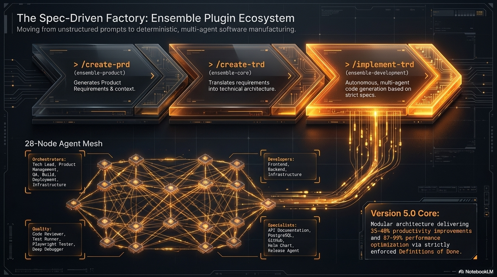

# Ensemble Plugins

Modular plugin ecosystem for AI coding agents (Claude Code first, plus Pi/Oh My Pi, OpenCode and Codex CLI). Ensemble packages a spec-driven workflow (PRD, TRD, Beads task graph, implementation, PR) together with framework skills, specialist agents and repository assessments. Install only the packages you need, or the full bundle.



Current release: **8.1.0** (`ensemble-full`). Each package is versioned independently; see [Packages](#packages).

## Contents

- [Quick start](#quick-start)
- [Installation](#installation)
- [Packages](#packages)
- [Commands](#commands)
- [The PRD to TRD to Beads to implementation workflow](#the-prd-to-trd-to-beads-to-implementation-workflow)
- [Assessment](#assessment)
- [Stack detection](#stack-detection)
- [Skills](#skills)
- [Agents](#agents)
- [Runtimes](#runtimes)
- [Upgrading to 7.0.0](#upgrading-to-700)
- [Configuration and model tiers](#configuration-and-model-tiers)
- [Development](#development)
- [Versioning](#versioning)
- [Documentation and links](#documentation-and-links)

## Quick start

In Claude Code:

```text
/plugin marketplace add Sunstone-Partners/ensemble
/plugin install ensemble-full@ensemble
```

Then, in a project:

```text
/ensemble-full:ensemble-create-prd "short product description"
/ensemble-full:ensemble-create-trd <prd-path>
/ensemble-full:ensemble-implement-trd-beads <trd-path> --plan
/ensemble-full:ensemble-implement-trd-beads <trd-path> --execute
```

`/ensemble-full:ensemble-feature new <idea>` runs the same idea-to-PR flow as one resumable, checkpointed run. For a read-only look at a repository, run `/ensemble-full:ensemble-assess repo`.

> **Command names.** `ensemble-full` ships skills only, so in Claude Code its commands are `/ensemble-full:ensemble-<name>`. The `/ensemble:<name>` form used elsewhere in this document is what the standalone plugins (for example `ensemble-development`) and the Pi, Codex and OpenCode runtimes use.

The full workflow needs the `br` (beads_rust) and `bv` (beads_viewer) CLIs on `PATH`. Walkthroughs live in the [user guide](docs/guides/user-guide.md).

## Installation

### Claude Code (marketplace)

Plugins are installed with Claude Code's `/plugin` command. The marketplace is `ensemble`.

```text
# Add the Ensemble marketplace
/plugin marketplace add Sunstone-Partners/ensemble

# Everything (all plugins bundled)
/plugin install ensemble-full@ensemble
```

Or use the interactive UI: `/plugin`, **Discover** tab, select a plugin, choose a scope.

### Per-package plugins

Install only what you need. Package names are the `name` fields in [marketplace.json](marketplace.json):

```text
# Foundation and workflow
/plugin install ensemble-core@ensemble
/plugin install ensemble-product@ensemble
/plugin install ensemble-development@ensemble
/plugin install ensemble-quality@ensemble
/plugin install ensemble-infrastructure@ensemble
/plugin install ensemble-git@ensemble
/plugin install ensemble-e2e-testing@ensemble
/plugin install ensemble-assessment@ensemble

# Framework skills
/plugin install ensemble-react@ensemble
/plugin install ensemble-nestjs@ensemble
/plugin install ensemble-dotnet@ensemble

# Test frameworks
/plugin install ensemble-jest@ensemble
/plugin install ensemble-pytest@ensemble
```

`ensemble-infrastructure` and `ensemble-quality` declare a dependency on `ensemble-core` (their agents call the `detect-stack` skill), and Claude Code installs it automatically from the same marketplace. Pi and Codex have no dependency mechanism, so install `ensemble-core` alongside those packages yourself.

### Installation scopes

- **User** (default): available across all your projects.
- **Project**: shared with collaborators via `.claude/settings.json`.
- **Local**: personal, per-repository, not shared.

### Pi / Oh My Pi

```bash
pi install @sunstone-partners/ensemble-pi

# Assessments are a separate Pi package (not bundled into ensemble-pi)
pi install @sunstone-partners/ensemble-assessment
```

Pi commands are invoked as `/ensemble-<command>` (Oh My Pi: `/skill:ensemble-<command>`). From a checkout use `pi install ./packages/pi`. See [packages/pi/README.md](packages/pi/README.md).

### Codex CLI (maintenance only)

Codex support only has to keep generating without errors; no new Codex-specific features are planned.

```bash
npm install -D @sunstone-partners/ensemble-codex
npx ensemble-codex-install . --force
```

From a checkout: `npm run generate:codex` then `npm run install:codex -- /path/to/project`. See [packages/codex/README.md](packages/codex/README.md).

### OpenCode

See [OpenCode support](#opencode-support).

### From a local checkout

```bash
git clone https://github.com/Sunstone-Partners/ensemble.git
claude --plugin-dir ./ensemble/packages/core
```

## Packages

Versions below are taken from each package's `package.json`.

| Package | Version | Contents |
|---------|---------|----------|
| `ensemble-full` | 8.1.0 | Meta-package that bundles all plugins |
| `ensemble-core` | 6.1.1 | `detect-stack` skill, `/ensemble:standards`, `fold-prompt`, `sessionlog`, `reinstall-plugins`, orchestration agents, XDG config |
| `ensemble-product` | 7.0.1 | PRD commands (`create-prd`, `refine-prd`, `prd`, `reqnroll`) and the product-management orchestrator |
| `ensemble-development` | 7.0.2 | TRD, Beads, feature and issue workflows; language skills; development agents |
| `ensemble-quality` | 6.0.2 | `pr-review-remediation` and `flake-reproduction` skills; code-reviewer, deep-debugger, test-runner agents |
| `ensemble-infrastructure` | 6.1.1 | Cloud, Kubernetes, Helm, Fly.io, Railway, Supabase, Vercel, Jira and Linear skills; infrastructure agents |
| `ensemble-git` | 6.1.1 | `/ensemble:pr-merge`, `/ensemble:release`; `git-town`, `changelog-generator`, `act-local-ci` skills; git agents |
| `ensemble-e2e-testing` | 6.1.1 | `/ensemble:author-playwright-tests`; `smoke-test-runner`, `writing-playwright-tests` skills; `playwright-tester` agent |
| `ensemble-assessment` | 2.0.0 | `/ensemble:assess` and the 22 assessment and report skills; installable on its own on Pi |
| `ensemble-react` | 7.0.1 | `react` skill |
| `ensemble-nestjs` | 6.0.1 | `nestjs` skill |
| `ensemble-rails` | 6.0.1 | `rails` skill |
| `ensemble-phoenix` | 6.0.1 | `phoenix` skill |
| `ensemble-blazor` | 7.0.1 | `blazor` skill |
| `ensemble-dotnet` | 2.0.1 | `dotnet` skill; `dotnet-backend-expert` agent |
| `ensemble-ai` | 7.0.1 | `anthropic`, `openai`, `perplexity`, `weaviate`, `langgraph` skills |
| `ensemble-jest` | 5.1.3 | `jest` skill |
| `ensemble-pytest` | 5.2.1 | `pytest` skill |
| `ensemble-rspec` | 5.2.1 | `rspec` skill |
| `ensemble-xunit` | 5.2.1 | `xunit` skill |
| `ensemble-exunit` | 5.1.2 | `exunit` skill |
| `ensemble-reqnroll` | 1.0.2 | `reqnroll` skill; `reqnroll-binding-specialist` agent |
| `ensemble-permitter` | 5.2.3 | Permission-expansion hook with allowlist (opt out with `ENSEMBLE_PERMITTER_DISABLE=1`) |
| `ensemble-opencode` | 5.4.1 | OpenCode runtime translation layer |
| `ensemble-pi` | 1.6.20 | Pi runtime translation layer (own version line) |
| `ensemble-codex` | 6.0.2 | Codex CLI runtime translation layer |
| `ensemble-agent-core` | 0.1.2 | Shared run-index I/O primitives for the `new-feature` and `fix-issue` workflows (library) |
| `ensemble-pi-extension` | 0.1.2 | Pi extension providing native command completion for the dispatcher commands (no marketplace entry; installed from a checkout) |

`ensemble-agent-core`, `ensemble-pi-extension` and the runtime layers are support packages; day-to-day use needs only the workflow and skill packages.

## Commands

Commands are invoked as `/ensemble:<name>` when installed through a standalone plugin, and as `/ensemble-full:ensemble-<name>` through the `ensemble-full` bundle (which ships the skills without the command stubs). The tree contains 41 command definitions (`packages/*/commands/*.yaml`), all of them skill-backed manifests. **33 are typable** and 8 are hidden behind a dispatcher or the wave runner (see [Hidden commands](#hidden-commands)). One more typable command, `/ensemble:init-project`, is hand-authored Markdown in `packages/core/commands/ensemble/` with no YAML source, so it is outside those counts and is not generated for Pi.

A command's prompt lives in a skill (`packages/<pkg>/skills/ensemble-<name>/SKILL.md`, plus `references/` for long phases), and the command itself is a thin entry point per runtime: a stub that reads the skill in Claude Code, a stub prompt in Pi, the skill itself in Codex, and a stub in OpenCode. To change what a command does, edit its skill, not its YAML. The six dispatchers (`prd`, `trd`, `issue`, `feature`, `reqnroll`, `standards`) are manifests like every other command; their routing table is the `## Subcommands` section of their `SKILL.md` (keyword, description, `/ensemble:<ref>` and the sibling path `../ensemble-<ref>/SKILL.md`), which the Pi extension reads for tab completion.

### Product and requirements

| Command | Arguments | Package | Purpose |
|---------|-----------|---------|---------|
| `/ensemble:prd` | `create`, `refine` plus subcommand args | product | Dispatcher for PRD authoring |
| `/ensemble:create-prd` | `[product-description] [--foreman]` or `--from-meeting <meeting-summary-or-path>` | product | Create a PRD with structured elicitation and adversarial review; `--from-meeting` builds it from a meeting summary |
| `/ensemble:refine-prd` | `<prd-path> [--from-meeting <summary-or-path> \| --foreman \| --collab [--tunnel=quick] [--reviewers N] [--no-open] \| --long-lived [--ttl <duration>]]` | product | Refine an existing PRD, or from a meeting summary |
| `/ensemble:reqnroll` | `features`, `feature-drift`, `bindings`, `binding-drift`, `tdd` plus subcommand args | product | Dispatcher for PRD-to-Reqnroll acceptance-test work |

### TRD and pre-implementation checks

| Command | Arguments | Package | Purpose |
|---------|-----------|---------|---------|
| `/ensemble:trd` | `create`, `refine`, `implement`, `analyze`, `complexity`, `validate`, `verify`, `status`, `graph` plus subcommand args | development | Dispatcher for TRD authoring, analysis and implementation |
| `/ensemble:create-trd` | `[prd-path] [--team] [--foundational] [--list] [--foreman] [--parser-tables]` | development | Create a TRD from a PRD; `--parser-tables` emits Foreman sprint/story tables |
| `/ensemble:refine-trd` | none | development | Refine an existing TRD |
| `/ensemble:analyze-complexity` | `[work-description] [--bead <id>] [--route <simple, medium, complex>] [--no-adaptive-planning] [--foreman]` | development | Score work complexity and choose a planning route |
| `/ensemble:analyze-requirements` | `[prd-path] [trd-path]` | development | Cross-artifact consistency sweep (PRD, TRD, beads) before coding |
| `/ensemble:validate-requirements` | `[prd-path] [trd-path]` | development | Traceability gate: REQ-NNN coverage and TEST task pairing |
| `/ensemble:verify-requirements` | `--trd <trd-path> [--prd <prd-path>] [--mode <auto, beads, checkbox, both>] [--report-path <path>] [--no-write-report] [--run-tests]` | development | Post-implementation REQ to AC to code traceability verifier |
| `/ensemble:requirement-status` | `[trd-path-or-slug]` | development | On-demand requirement satisfaction report from bead comments |
| `/ensemble:trd-dependency-graph` | `[trd-dir\|paths...] [--format <json, mermaid, dot>] [--overlap]` | development | Dependency graph across TRDs and likely-duplicate work report |
| `/ensemble:configure-team` | `[trd-path] [--team] [--no-team]` | development | Derive team roles, agent assignments and plugins from TRD complexity |

### Beads planning and implementation

| Command | Arguments | Package | Purpose |
|---------|-----------|---------|---------|
| `/ensemble:implement-trd-beads` | `[trd-path] [--plan] [--execute] [--branch=<name>] [--use-current-branch] [--status] [--reset-task TRD-XXX] [--list] [max parallel N] [--foreman]`, or `<trd-path> <trd-path>... --workstream [--generate-only [--out <path>] [--allow-invalid]]` | development | TRD implementation on a persistent bead hierarchy |
| `/ensemble:beads-build` | `[epic-id\|slug-pattern] [--trd trd-path] [--strategy <name>] [--label <label>] [max parallel N]` | development | Drive an existing hierarchy to completion through builder, review and close |
| `/ensemble:implement-bead` | `<bead-id>` | development | Implement one bead through analysis, implementation and PR |
| `/ensemble:list-issue` | `[--ranked \| --robot-triage]` | development | List open Beads issues for triage |

`--strategy` accepts `tdd`, `characterization`, `bug-fix`, `refactor`, `test-after` or `flexible`.

### Feature and issue lifecycle

| Command | Arguments | Package | Purpose |
|---------|-----------|---------|---------|
| `/ensemble:feature` | `new`, `resume`, `status`, `abandon` plus args | development | Front door: use this one. A keyword dispatcher over `new-feature` |
| `/ensemble:new-feature` | `--idea`, `--status`, `--abandon`, `--foreman` | development | The engine: the checkpointed idea-to-PR workflow that `feature` forwards to (PRD, TRD, beads, implementation, optional PR) |
| `/ensemble:issue` | `fix`, `list`, `resume`, `status`, `abandon` plus args | development | Dispatcher for issue work |
| `/ensemble:fix-issue` | none | development | Lightweight bug-fix workflow |

`feature` and `new-feature` are two layers of one workflow, not alternatives. `new-feature` owns the stage machine and run state (`.ensemble/new-feature/`) and takes flags. `feature` owns only the keyword UX: it validates the keyword, rewrites it into the matching `new-feature` flags (`new <idea>` becomes `--idea "<idea>"`, `status` becomes `--status`), and then follows `new-feature`'s skill, so it cannot work without it. Start with `feature`; call `new-feature` directly only to pass flags the keywords don't cover. `issue` and `fix-issue` follow the same pattern.

### Git, testing and delivery

| Command | Arguments | Package | Purpose |
|---------|-----------|---------|---------|
| `/ensemble:pr-merge` | `[pr-number-or-url] [--max-rounds=N] [--dry-run]` | git | Drive an open PR to green and merged, one subagent per failing check or review thread |
| `/ensemble:release` | none | git | Release workflow via `git-workflow` and `deployment-orchestrator` |
| `/ensemble:author-playwright-tests` | `[story-or-pr-reference]` | e2e-testing | Interactive Playwright test authoring grounded in shipped code and PRD acceptance criteria |

### Assessment, standards and utilities

| Command | Arguments | Package | Purpose |
|---------|-----------|---------|---------|
| `/ensemble:assess` | `repo`, `team`, `config`, `report`; `repo --only <dimension>` | assessment | Dispatcher for assessments; see [Assessment](#assessment) |
| `/ensemble:standards` | `discover`, `inject`, `fold` plus subcommand args | core | Dispatcher for coding-standards work |
| `/ensemble:fold-prompt` | none | core | Optimize `CLAUDE.md` for token efficiency and progressive context loading |
| `/ensemble:init-project` | `minimal`, `force` | core | Scaffold `docs/standards/constitution.md`, `docs/PRD/` and `docs/TRD/` and the `.gitignore` entries for a project; run it when the Constitution Gate halts |
| `/ensemble:sessionlog` | none | core | Save a structured session transcript to SessionLogs |
| `/ensemble:reinstall-plugins` | `[--all \| <filter>]` | core | Force-refresh installed plugins (uninstall and reinstall) |

### Hidden commands

Eight commands are marked `metadata.visibility: hidden` in their YAML. They cannot be typed under their own name; their dispatcher (or the wave runner) loads them.

| Hidden command | Reached through |
|----------------|-----------------|
| `generate-feature-tests` | `/ensemble:reqnroll features` |
| `check-feature-drift` | `/ensemble:reqnroll feature-drift` |
| `generate-reqnroll-bindings` | `/ensemble:reqnroll bindings` |
| `check-binding-drift` | `/ensemble:reqnroll binding-drift` |
| `reqnroll-tdd` | `/ensemble:reqnroll tdd` |
| `discover-standards` | `/ensemble:standards discover` |
| `inject-standards` | `/ensemble:standards inject` |
| `beads-build-wave` | Dispatched internally by `/ensemble:beads-build` (one scheduling wave per invocation) |

`fold-prompt` stays typable.

### Collaborative refinement review

`/ensemble:refine-prd` and `/ensemble:refine-trd` accept `--collab`, which replaces the terminal interview with a browser-based HTML review: each question renders in a sidebar with anchor-linked comments, and the session writes a `.response.json` artifact that the enhancement phase reads.

```bash
# Local-only review
/ensemble:refine-prd --collab docs/PRD/PRD-2026-019.md

# Remote review over a Cloudflare Quick Tunnel (no account, DNS or token)
/ensemble:refine-prd --collab --tunnel=quick docs/PRD/PRD-2026-019.md
```

`--tunnel=quick` requires the [`cloudflared`](https://github.com/cloudflare/cloudflared) binary on `PATH` (or `CLOUDFLARED_PATH` set to its absolute path). Completed sessions can be re-opened by re-running with `--collab` against the same path; to start over, delete the session file under `~/.config/ensemble/logs/refinement-review/`. Details: [docs/guides/refinement-review-collab.md](docs/guides/refinement-review-collab.md).

### Review metrics and the reviewer eval set

`pr-review-cli.js` (in `ensemble-development`, reached through the `pr-review-cycle` and
`pr-review-eval` skills) computes the review-process metrics and the reviewer eval score by hand —
no dashboard, no scheduler, no new dependency:

| Subcommand | Answers |
|---|---|
| `metrics` | Per-cohort human approvals per PR (median and p95), human comments, wait-on-human hours, rounds-to-pass, the share of PRs needing five or more rounds, and the noise rate. Bot reviewers are never counted. |
| `metrics-compare` | A post-change cohort against the committed baseline: every target graded relative to baseline, plus a revert/incident guardrail that fails the cohort on its own. |
| `walltime` | Review wall time by tier against the committed wall-time baseline (`docs/guides/review-walltime-baseline-<date>.json`): median and p75 per tier and round, gate runs and review chains per PR, and whether the 5x claim may be made. A tier with fewer than three PRs on either side is `unknown`, never `met`, and the claim is withheld unless a real re-review that carried verdicts is in the data. See [docs/guides/pr-review-walltime.md](docs/guides/pr-review-walltime.md). |
| `eval-score` | Whether the reviewer found the bug in each eval case (a PR that caused an incident or a revert, confirmed by the code owner of the affected area). |
| `eval-compare` | This eval run against the previous one, naming regressions. |
| `eval-stale` | Which cases need re-review because their area's review rules changed. |

The `pr-review-eval` skill walks a maintainer through adding a case
(`docs/review-eval/cases/<id>.json`) and through running the eval set when the reviewer's rules,
prompts or model change. Recurrence is the host repository's responsibility; ensemble runs no
recurring job of its own.

**Entry criterion — capture the baseline first.** A comparison only means something against a
baseline captured *before* the review changes land, so the baseline cohort is captured once (at
least 20 PRs **and** at least 30 days) and committed as `docs/guides/review-baseline-<date>.json`.
It is never edited in place: a baseline that moves proves nothing. A cohort that misses either
floor comes back `insufficient` with no targets graded at all. Procedure:
[docs/guides/pr-review-metrics.md](docs/guides/pr-review-metrics.md), which extends §6 of
[docs/guides/pr-review-cycle-time-pilot.md](docs/guides/pr-review-cycle-time-pilot.md).

### Risk tiers, human approvals and the merge gate

Every PR is reviewed and approved at a risk tier derived from **the change itself**, never from
who wrote it. The tier decides how many people must approve before `pr-merge` will merge:

| Effective tier | Human approvals required | Typical change |
|---|---|---|
| Low | 0 | docs or copy only — **and only with the Low waiver enabled** (see below) |
| Medium | 1 | the default for ordinary product changes |
| High | 2 | sensitive paths, or a second assessment saying another person is needed |

**Strict by default.** The Low tier is *treated as Medium* unless the `lowWaiver` policy key is
explicitly enabled with its evidence. A fresh repository therefore requires a human approval on
every PR that is not already covered, and nothing silently drops to zero reviewers.

**Raise-only.** An agent or the author may *propose* a tier. A proposal that raises the tier is
accepted from anyone; a proposal that lowers it is **ignored** and recorded as
`lowering-needs-code-owner` unless a code owner of the affected path makes it. Lowering the
assigned tier still does not bypass the Low-waiver rule above.

**Approvals are bound to a commit and to a person.** An approval counts only when it is bound to
the commit (or tree) under review, so a push invalidates it. Bot approvals never count. Where an
agent authored the PR on a person's instruction, the `Directed by:` line in the PR body makes that
person count as one of the required reviewers, as if they had written the code themselves. It is a
line the PR's author writes, so it never lowers a requirement on its own: the `soloMaintainer`
discount below needs that person's own approval of the head unless they are the PR's author, in
which case it rests on their own credit as author-as-director.

Policy keys live in the fenced `ensemble-review-policy` block of the **root `REVIEW.md` on the base
branch** — never the PR head, so a PR cannot loosen its own review:

| Key | Meaning | Default |
|---|---|---|
| `roundCap` | Shared review-round cap before escalating to the author | `3` (valid 1–5) |
| `lowWaiverEnabled` | Whether a Low-tier PR may merge with no human approval | `false` |
| `soloMaintainer` | With exactly one maintainer login, a High PR that touches no sensitive path and was directed by that maintainer needs one human instead of two. A maintainer who is not the PR's author must have approved the current head on the host; a maintainer who is the author (an agent PR under their own login) is credited on their own word as author-as-director, with the warning `solo-maintainer-self-credit` in the result (a `Directed by:` line alone never lowers it for anyone else); the security lane still blocks | `false` |
| `botLogins` | Logins whose approvals are never counted | empty |
| `maintainerLogins` | Logins eligible to enable the Low waiver | empty |
| `sensitivePaths` / `highPaths` | Globs that floor the tier at Medium / High | empty |

> **Recommended: turn on branch protection.** These gates run where ensemble runs, so they cannot
> stop a direct push or a merge made outside `pr-merge`. Ensemble reports when server-side
> enforcement is absent, and recommends it, but **cannot enforce it**. For the guarantee, configure
> a GitHub branch-protection rule on the default branch requiring pull requests and at least the
> number of approving reviews your highest tier expects (2 for High), with stale approvals
> dismissed on new commits. `pr-merge` prints a `SERVER-SIDE ENFORCEMENT ABSENT` notice with the
> rule to configure whenever it finds the base branch unprotected.

## The PRD to TRD to Beads to implementation workflow

```text
create-prd  ->  create-trd  ->  (validate/analyze)  ->  implement-trd-beads  ->  PR
 PRD             TRD with REQ/AC      gates              bead hierarchy,        pr-merge
                 and task list                           builder + review
```

1. **PRD**: `/ensemble:create-prd` elicits requirements and runs an adversarial review and the Constitution Gate. Refine with `/ensemble:refine-prd`.
2. **TRD**: `/ensemble:create-trd <prd-path>` designs architecture and a Master Task List with test tasks and acceptance criteria. Refine with `/ensemble:refine-trd`.
3. **Gates** (optional): `/ensemble:validate-requirements` and `/ensemble:analyze-requirements` check REQ coverage, TEST pairing and PRD/TRD/beads alignment before coding.
4. **Beads**: `/ensemble:implement-trd-beads <trd-path> --plan` scaffolds an epic, stories and tasks with `br`, validated with `bv --robot-*`. `--execute` runs the dependency-aware build loop.
5. **Verify**: `/ensemble:verify-requirements --trd <trd-path>` and `/ensemble:requirement-status` report traceability.
6. **Land**: `/ensemble:pr-merge` drives the PR to green.

`/ensemble:feature` wraps the whole chain in one checkpointed, resumable run (`new`, `resume`, `status`, `abandon`).

### Branch selection

`--branch=<name>` and `--use-current-branch` are mutually exclusive. `--branch=<name>` switches to an existing branch; `--use-current-branch` works on the checked-out branch. With neither flag, the command auto-detects a local branch matching the TRD slug, then reads saved branch intent from the TRD frontmatter (`ensemble_implement_trd_beads: {branch_name, use_proposed, stacked_prs}`), then falls back to the pr-plan proposed branch. Priority: explicit flags, auto-detect, saved frontmatter, pr-plan.

### Multi-TRD workstreams

Passing two or more TRD paths directly now halts with an error. Generate one normalized workstream TRD instead:

```bash
# Generate only (no beads, branches, commits or PRs), then implement the result
/ensemble:implement-trd-beads --workstream --generate-only docs/TRD/TRD-2026-001-api.md docs/TRD/TRD-2026-002-ui.md
/ensemble:implement-trd-beads docs/TRD/workstreams/<generated-file>.md --plan --use-current-branch

# Or generate and implement in one step
/ensemble:implement-trd-beads docs/TRD/TRD-2026-001-api.md docs/TRD/TRD-2026-002-ui.md --workstream
```

`--generate-only` requires `--workstream` and cannot be combined with `--plan`, `--execute`, `--status`, `--reset-task`, `--list`, `--branch` or `--use-current-branch`. `--out <path>` and `--allow-invalid` (write the workstream file even when source TRD validation fails) are only used together with `--generate-only`. The default output path is `docs/TRD/workstreams/TRD-YYYY-<micro_uuid>-workstream-<slug>.md`. More in [packages/development/README.md](packages/development/README.md).

### Foreman table mode

`/ensemble:create-trd <prd-path> --parser-tables` produces a Foreman-native TRD with parser-compatible sprint/story tables and no adversarial review. It is not the same as `--foreman`, which keeps the standard checkbox TRD and only makes the run non-interactive with Foreman artifact contracts; the two flags combine.

### Reqnroll acceptance tests

For .NET projects, `/ensemble:reqnroll` turns PRD acceptance criteria into Gherkin features, step bindings and a test-first loop, with drift checks (`features`, `feature-drift`, `bindings`, `binding-drift`, `tdd`). `create-trd` and `implement-trd-beads` use the Reqnroll path (`-TEST` tasks scaffolded as features, step bodies delegated to `reqnroll-binding-specialist`) by default, as before; a repo that does not use Reqnroll opts out with `--no-bdd` or `ENSEMBLE_BDD=0` and gets the repo's own test framework. See [Optional BDD](packages/development/README.md#optional-bdd-reqnroll).

## Assessment

`ensemble-assessment` provides `/ensemble:assess`, a single dispatcher over the assessment skills:

| Invocation | Runs |
|------------|------|
| `/ensemble:assess repo [args]` | Full parallel repository assessment (`assess-repo`) |
| `/ensemble:assess repo --only <dimension>` | One repository dimension through its leaf skill |
| `/ensemble:assess team [args]` | Team assessment (`assess-team`) |
| `/ensemble:assess config` | Portfolio-local assessment configuration (`assess-config`) |
| `/ensemble:assess report` | End-to-end report suite (`assessment-report-suite`) |

`assess-repo` and `assess-team` are thin dispatchers over their leaf skills, which stay individually invocable:

| Group | Skills |
|-------|--------|
| Repository dimensions | `assess-ai-readiness`, `assess-architect`, `assess-cicd`, `assess-code-quality`, `assess-purpose`, `assess-security`, `assess-testing` |
| Team dimensions | `assess-team-dimension` (commit messages, code quality, test coverage, AI adoption, documentation, code review) |
| Reports and audits | `ai-readiness-diagnostic-report`, `architecture-overview-report`, `assessment-report-suite`, `assessment-scoring-conflation-audit` |
| Setup | `assess-config` |

## Stack detection

The four former detector skills are one skill, `detect-stack`, in `ensemble-core`. It uses weighted multi-signal confidence scoring and one CLI:

```bash
node packages/core/skills/detect-stack/detect-stack.js <path> --axis=framework|test|tooling|cloud|all
```

Other options: `--framework=<name>`, `--provider=<name>`, `--tools=<comma-separated list>` and `--min-confidence=<0-1>`. The output is one JSON envelope with `axis`, `detected`, `primary`, `confidence`, `threshold`, `results` and `all_results`; exit codes are `0` detected, `1` nothing detected, `2` error. Agents in `ensemble-infrastructure` and `ensemble-quality` call it, which is why those packages depend on `ensemble-core`.

## Skills

Skill directories use the bare technology name. The tree has 58 source skill directories (`packages/*/skills/<name>/`).

| Package | Skills |
|---------|--------|
| core | `detect-stack` |
| development | `completion-verification`, `pr-review-cycle`, `pr-review-eval`, `pr-review-explainer`, `pr-review-sweep`, `staleness-gate`, `tool-path-resolution` |
| infrastructure | `aws`, `kubernetes`, `helm`, `flyio`, `railway`, `supabase`, `vercel`, `jira`, `linear` |
| git | `git-town`, `changelog-generator`, `act-local-ci` |
| quality | `pr-review-remediation`, `flake-reproduction` |
| e2e-testing | `smoke-test-runner`, `writing-playwright-tests` |
| ai | `anthropic`, `openai`, `perplexity`, `weaviate`, `langgraph` |
| assessment | `ensemble-assess` and the 22 assessment skills listed under [Assessment](#assessment) |
| Frameworks | `react` (ensemble-react), `nestjs`, `rails`, `phoenix`, `blazor`, `dotnet` (ensemble-dotnet) |
| Testing | `jest`, `pytest`, `rspec`, `xunit`, `exunit`, `reqnroll` |

`smoke-test-runner` covers the API, auth, critical-path, database and external-service smoke categories in one skill.

## Agents

24 agent definitions across the packages:

| Package | Agents |
|---------|--------|
| core | `ensemble-orchestrator` |
| development | `advisor`, `architect`, `backend-developer`, `beads-build-wave`, `beads-scaffold-specialist`, `documentation-specialist`, `frontend-developer`, `tech-lead-orchestrator` |
| dotnet | `dotnet-backend-expert` |
| e2e-testing | `playwright-tester` |
| git | `git-workflow` |
| infrastructure | `build-orchestrator`, `deployment-orchestrator`, `helm-chart-specialist`, `infrastructure-developer`, `infrastructure-orchestrator`, `infrastructure-specialist`, `postgresql-specialist` |
| product | `product-management-orchestrator` |
| quality | `code-reviewer`, `deep-debugger`, `test-runner` |
| reqnroll | `reqnroll-binding-specialist` |

## Runtimes

| Aspect | Claude Code | Pi / Oh My Pi | Codex CLI |
|--------|-------------|---------------|-----------|
| Package | Plugins from the `ensemble` marketplace | `@sunstone-partners/ensemble-pi` (+ `ensemble-assessment`) | `@sunstone-partners/ensemble-codex` |
| Command syntax | `/ensemble:<name>` | `/ensemble-<name>`; Oh My Pi `/skill:ensemble-<name>` | Command skills `.codex/skills/commands/ensemble-*/SKILL.md` |
| Hidden commands | Generated with `user-invocable: false`: absent from the slash menu, still invocable by the model through the dispatcher | Written to `prompts/_hidden/` with no wrapper skill; `pi.prompts` is `./prompts/*.md` (non-recursive), so Pi does not register them | Wrapper skill is generated with `user-invocable: false` (not verified on a live Codex) |
| Dependencies | Installed automatically from the marketplace | None; install `ensemble-core` yourself | None; install `ensemble-core` yourself |
| Status | Primary | Supported; `ensemble-pi` is on its own version line (1.6.16) | Maintenance only |

Pi generation prunes stale output only when a file carries the generator's own marker, so hand-authored files survive.

### OpenCode support

`ensemble-opencode` translates Ensemble agents, commands and skills to OpenCode formats.

```bash
# Generate all OpenCode artifacts to dist/opencode/
npm run generate:opencode

# Preview without writing files, or validate against the OpenCode schema
npm run generate:opencode -- --dry-run
npm run generate:opencode -- --validate

# Custom output directory
npm run generate:opencode -- --output-dir ./my-output
```

Add the plugin in `opencode.json`:

```jsonc
{
  "plugin": ["ensemble-opencode"]
}
```

For local development use `"plugin": ["file:///absolute/path/to/packages/opencode"]`. Local `file://` installs load command definitions from the source YAML when `dist/opencode/opencode.json` has not been generated. Commands resolve under both namespaced and plain names (`/ensemble:create-prd` and `/create-prd`). Output layout:

```text
dist/opencode/
  .opencode/
    agents/            # Agent markdown files
    commands/ensemble/ # Translated command files
    skill/             # Skill files
  opencode.json        # OpenCode configuration manifest
```

## Upgrading to 7.0.0

7.0.0 is a MAJOR release because skills, commands and agents were renamed or removed. Full detail: [CHANGELOG.md](CHANGELOG.md).

### Skill renames

Anything that loads a skill by name must use the new name.

| Old | New |
|-----|-----|
| `developing-with-typescript`, `developing-with-python`, `developing-with-php`, `developing-with-laravel`, `developing-with-flutter`, `styling-with-tailwind`, `using-prisma`, `using-celery` | Removed (generic tutorial skills; no replacement) |
| `managing-jira-issues`, `managing-linear-issues` | `jira`, `linear` |
| `managing-railway`, `managing-vercel`, `managing-supabase` | `railway`, `vercel`, `supabase` |
| `aws-cloud` | `aws` |
| `using-weaviate` | `weaviate` |
| `using-anthropic-platform`, `using-openai-platform`, `using-perplexity-platform` | `anthropic`, `openai`, `perplexity` |
| `building-langgraph-agents` | `langgraph` |
| `dotnet-framework` (ensemble-blazor) | `dotnet` (ensemble-dotnet) |
| `developing-with-react` | folded into `react` (also now in `ensemble-full`) |
| `smoke-test-api`, `smoke-test-auth`, `smoke-test-critical-paths`, `smoke-test-database`, `smoke-test-external-services` | `smoke-test-runner` |
| `framework-detector`, `test-detector`, `tooling-detector`, `cloud-provider-detector` | `detect-stack` with `--axis=framework`, `test`, `tooling` or `cloud` (`--tool x` is now `--tools=x`) |

### Commands

| Old | New |
|-----|-----|
| `/ensemble:create-prd-meeting` | `/ensemble:create-prd --from-meeting` |
| `/ensemble:refine-prd-meeting` | `/ensemble:refine-prd --from-meeting` |
| `/ensemble:create-trd-foreman` | `/ensemble:create-trd --parser-tables` |
| `/ensemble:create-workstream-trd` | `/ensemble:implement-trd-beads <trd> <trd> --workstream --generate-only` |
| `/ensemble:generate-feature-tests`, `check-feature-drift`, `generate-reqnroll-bindings`, `check-binding-drift`, `reqnroll-tdd` | `/ensemble:reqnroll features`, `feature-drift`, `bindings`, `binding-drift`, `tdd` |
| `/ensemble:discover-standards`, `inject-standards` | `/ensemble:standards discover`, `inject` |
| `assess-repo` / `assess-team` / `assess-config` / report skills invoked directly | `/ensemble:assess repo`, `team`, `config`, `report` (leaf skills remain invocable) |
| `/ensemble:claude-changelog` (removed) | Use the `changelog-generator` skill |
| `/ensemble:beads-plan` | `/ensemble:beads-build --plan` (read-only plan mode) |
| `/ensemble:generate-api-docs`, `/ensemble:analyze-product`, `/ensemble:manager-dashboard` (removed) | None |
| `/ensemble:sprint-status`, `/ensemble:web-metrics-dashboard` (removed) | None |
| `/ensemble:playwright-test` (removed) | `/ensemble:author-playwright-tests` or the `playwright-tester` agent |

The `trd` dispatcher no longer has `foreman` or `workstream` keywords, and the `prd` dispatcher no longer has `create-meeting` or `refine-meeting`; the flags above go on `create`, `refine` and `implement`. Typable commands went from 44 to 35.

### Removed agents

- `release-agent`: duplicate of `/ensemble:release`, which delegates to `git-workflow` and `deployment-orchestrator`.
- `general-purpose`, `file-creator`, `context-fetcher`, `agent-meta-engineer`, `directory-monitor`, `pm`, `api-documentation-specialist`, `mobile-developer`, `qa-orchestrator` (use `test-runner`), `github-specialist` (merged into `git-workflow`).
- The `ensemble-router` and `ensemble-metrics` packages.
- `test-reader-agent`: fixture agent.

### Behavior changes

- `create-prd --from-meeting` now runs the Constitution Gate like every other `create-prd` run. A repo with no constitution file halts with `CONSTITUTION_CONFIG_ERROR`, where the old variant did not. It is mutually exclusive with `--foreman` (and with `--collab` and `--long-lived` on refine). Meeting-sourced drafts carry the standard frontmatter label.
- Lifecycle hooks keyed on the old names (`ensemble:create-prd-meeting`, `ensemble:refine-prd-meeting`, `ensemble:create-trd-foreman`) must be re-keyed on `ensemble:create-prd`, `ensemble:refine-prd` and `ensemble:create-trd`. See [docs/guides/command-lifecycle-hooks.md](docs/guides/command-lifecycle-hooks.md).
- `create-trd --parser-tables`: the former "skip to Output Management" path now routes through the Constitution Gate.
- `ensemble-blazor` library API: `loadSkill`, `getTemplate` and `getExample` no longer take a `skillName` argument, and `skill.skills` is now `['blazor']`, because `dotnet-framework` moved to `ensemble-dotnet`. This affects only external consumers of `lib/index.js`.
- `rspec` and `xunit` skills are now full skills with working helper scripts (`generate-test.rb` and `run-test.rb` for RSpec; `generate-test.cs` and `run-test.sh` for xUnit), located directly in the skill directory. The generated placeholder test is no longer a passing test (`skip` for RSpec, `Assert.Fail` for xUnit), so a scaffold cannot be mistaken for coverage. `xunit/generate-test.cs` needs the .NET 10 SDK (`dotnet run generate-test.cs`).
- `ensemble-assessment` is Pi-installable on its own and is no longer bundled into `ensemble-pi`; install both if you want both.
- `ensemble-infrastructure` and `ensemble-quality` now declare `ensemble-core` as a dependency (Claude Code installs it; Pi and Codex do not).
- Direct multi-TRD invocation of `implement-trd-beads` is rejected; use `--workstream`.
- Package versions moved to new majors for packages whose surface changed: `ensemble-ai`, `ensemble-blazor`, `ensemble-codex`, `ensemble-core`, `ensemble-e2e-testing`, `ensemble-git`, `ensemble-infrastructure`, `ensemble-product`, `ensemble-quality`, `ensemble-react` are 6.0.0; `ensemble-development` and `ensemble-full` are 7.0.0. Dependency ranges (`^6.0.0`, `^7.0.0` for development) were updated accordingly.

After upgrading, refresh installed plugins with `/ensemble:reinstall-plugins`.

## Configuration and model tiers

Command sources declare an abstract tier (`high`, `medium`, `low`) in YAML `metadata.model`. At generation time these map to Claude Code's portable model aliases, which resolve per provider (Anthropic API, Bedrock, Vertex) at runtime, so there is no per-project model config to maintain:

| Tier | Claude Code alias | Typical use |
|------|-------------------|-------------|
| `high` | `opus` | Strategic reasoning, architecture, security review |
| `medium` | `sonnet` | Implementation, documentation, testing |
| `low` | `haiku` | Lightweight retrieval, file watching |

Ensemble uses XDG-compliant configuration paths, chosen in this order:

1. `$XDG_CONFIG_HOME/ensemble/` if `XDG_CONFIG_HOME` is set
2. `~/.config/ensemble/` if `~/.config` exists
3. `~/.ensemble/` as the fallback

Config, logs, cache and session data live under that directory. To migrate legacy ai-mesh directories:

```bash
node scripts/migrate-config.js --dry-run   # preview
node scripts/migrate-config.js             # migrate
node scripts/migrate-config.js --force     # overwrite existing files
```

Environment variables are documented in [docs/guides/environment-variables.md](docs/guides/environment-variables.md).

### Ensemble and Foreman boundary

Ensemble is the portable behavior-definition, packaging, validation and local agent-harness project. It describes, validates, packages, simulates and locally runs behavior; it does not activate, govern, schedule, execute, recover or audit production behavior. That is Foreman's job, in a separate repository.

```text
Ensemble = describe, validate, package, simulate, and locally run behavior
Foreman  = activate, govern, schedule, execute, recover, and audit production behavior
Pi/OMP   = provide the agent loop and invocation substrate
```

The Elixir activation runner in `packages/core` is not a Pi/OMP adapter; the Pi/OMP-facing integration is the TypeScript extension in `packages/pi-extension`.

## Development

```text
ensemble/
  packages/        # Individual plugins
  schemas/         # Validation schemas
  scripts/         # Build, generation and validation scripts
  docs/            # Guides, plans, PRDs and TRDs
  marketplace.json # Plugin registry
```

```bash
git clone https://github.com/Sunstone-Partners/ensemble.git
cd ensemble
npm install
npm run validate   # schemas, version sync, model-id lint
npm test           # workspace tests
```

Command and agent sources are YAML under `packages/<pkg>/commands/` and `packages/<pkg>/agents/`. After editing them run `npm run generate` (Markdown), and `npm run generate:pi`, `npm run generate:opencode` or `npm run generate:codex` for the runtime layers. Generated Markdown under `packages/<pkg>/commands/ensemble/` is not edited by hand. See [CLAUDE.md](CLAUDE.md) and [CONTRIBUTING.md](CONTRIBUTING.md) for conventions.

### Creating a new plugin

```bash
mkdir -p packages/my-plugin/{.claude-plugin,agents,commands,skills,lib,tests}
```

Create `packages/my-plugin/.claude-plugin/plugin.json`:

```json
{
  "name": "ensemble-my-plugin",
  "version": "1.0.0",
  "description": "My custom plugin",
  "author": { "name": "Your Name", "email": "you@example.com" },
  "license": "Apache-2.0",
  "keywords": ["my-plugin", "ensemble"],
  "agents": "./agents",
  "commands": "./commands",
  "skills": "./skills"
}
```

Then add `packages/my-plugin/package.json`, the agents, commands and skills, register the plugin in `marketplace.json`, and run `npm run validate` and `npm test`.

## Versioning

All plugins follow [Semantic Versioning](https://semver.org/) and every plugin is versioned independently. `claude plugin install` and `claude plugin update` gate on the plugin's own `.claude-plugin/plugin.json` version, so a package whose version does not move never re-syncs on a consuming machine; a per-package bump is what ships a change.

`npm run validate` enforces that each package agrees with itself: `packages/<name>/package.json`, `packages/<name>/.claude-plugin/plugin.json` and that package's `marketplace.json` entry carry the same version (`scripts/validate-version-sync.js`). The exception is the release set: root `package.json`, `packages/full/` and the `ensemble-full` marketplace entry must match each other before tagging.

## Documentation and links

- [User guide](docs/guides/user-guide.md): task-oriented walkthroughs.
- [Wiki](https://github.com/Sunstone-Partners/ensemble/wiki): architecture, command and skill references. The [Architecture page](https://github.com/Sunstone-Partners/ensemble/wiki/02-Architecture) has the package graph and the [Commands Reference](https://github.com/Sunstone-Partners/ensemble/wiki/07-Commands) the long-form command docs.
- [CHANGELOG.md](CHANGELOG.md): release history and the full 7.0.0 notes.
- [CONTRIBUTING.md](CONTRIBUTING.md) and [CLAUDE.md](CLAUDE.md): contribution workflow and repository conventions.
- [Ensemble vs. Spec-Kit](docs/comparison-other-frameworks.md) and [Ensemble vs. BMAD vs. Spec-Kit](docs/comparison-bmad.md): framework comparisons.
- [Issues](https://github.com/Sunstone-Partners/ensemble/issues) and [Discussions](https://github.com/Sunstone-Partners/ensemble/discussions).

## License

Apache License 2.0. See [LICENSE](LICENSE) and [NOTICE](NOTICE).

---

**Maintained by Sunstone Partners** | [Website](https://sunstonepartners.com) | [GitHub](https://github.com/Sunstone-Partners)
