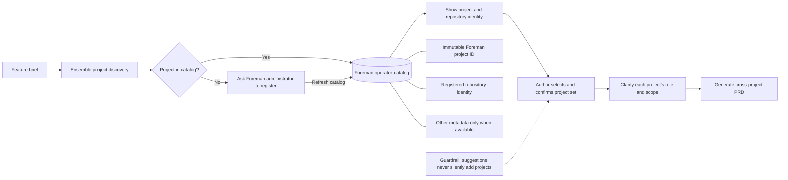
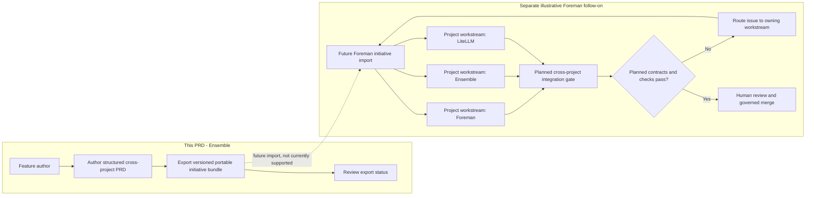
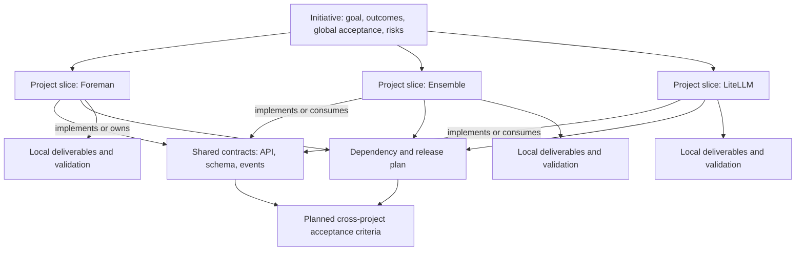

# PRD-2026-76ad91ea: Cross-Project PRD Authoring in Ensemble

## PRD Health Summary

| Metric | Value |
|---|---|
| Document ID | PRD-2026-76ad91ea |
| Version / Status | 1.0.3 / Locked |
| Date / Scale depth | 2026-11-16 / LIGHT |
| Readiness score | 4.50 / 5.00 (unchanged from 4.50) |
| Functional / Non-Functional | 10 / 2 |
| Priority counts | Must 10, Should 2, Could 0, Won't 0 |
| Acceptance criteria | 36 total; 12/12 requirements covered (100%) |
| Risk flags | 9 requirements: REQ-001, REQ-003, REQ-004, REQ-005, REQ-006, REQ-008, REQ-009, REQ-010, REQ-011 |
| Cross-requirement dependencies | 21 |
| Constitution compliance | passed |

## Product Summary

**Problem:** A feature that crosses repositories currently forces its author to discover project boundaries, define a coherent plan, and coordinate separate agent sessions manually. The resulting plans can omit a participating project, blur project-specific scope, or leave shared contracts and sequencing unclear.

**Solution:** Extend Ensemble’s PRD-authoring flow to discover projects from Foreman’s operator-level project catalog, let the feature author explicitly select participating projects, and produce one PRD plus a portable, versioned initiative bundle with project-specific workstreams, shared contracts, and acceptance criteria. Ensemble owns authoring/export only. Cross-project initiative import, execution, dispatch, and durable coordination require separate Foreman-owned work.

**Value proposition:** The feature author gets one reviewable plan that names the projects and their roles before implementation, reducing coordination overhead and making cross-project dependencies visible to project leads and coding agents.

**Target users:**
- **Feature author:** selects the project set, defines the outcome, and approves the complete PRD.
- **Project lead:** reviews the scope and obligations for their project slice.
- **Implementation agent:** consumes a bounded project slice and its dependencies.

**Research context:** Ensemble is a TypeScript/Node.js plugin and package ecosystem. Its constitution explicitly excludes durable production scheduling, activation, retries, recovery, and a competing dispatcher. Foreman’s project list reads the operator’s project catalog; its project CRUD PRD explicitly excludes project access control/RBAC and multi-tenant namespaces. Foreman supports per-project multi-repository runs and fan-out, not a distinct-project initiative controller or shared cross-project dependency/integration gate. This PRD therefore limits catalog discovery to trusted operator-context use and defines a portable export only. Foreman import and execution require separate Foreman-owned work.

## User Analysis

The feature author’s current workaround is manually running and coordinating separate project sessions. Their main need is to decide the project set and settle shared requirements before implementation begins. Project leads need a clear, reviewable slice rather than an undifferentiated global prompt. Agents need project identity, scope, dependencies, and acceptance conditions that can be associated with the right repository.

Success for this PRD is a confirmed project set and a useful structured PRD that can be exported with project identities, project-specific scopes, shared contracts, dependencies, and acceptance criteria. Coordinated implementation is a later outcome dependent on a separate Foreman-owned deliverable.

## Goals and Non-Goals

**Goals:**
- Let a feature author in a trusted operator context discover and explicitly choose projects from Foreman’s operator-level catalog.
- Represent implementation workstreams and stakeholder-only project references distinctly.
- Capture shared contracts, unresolved decisions, dependencies, and project-specific acceptance criteria in one PRD.
- Preserve stable project identity through review and portable export.
- Keep authoring and approval in Ensemble; export a structured plan without implying that execution has started.

**Non-Goals:**
- Implement Foreman’s project catalog, authorization policy, durable initiative control plane, scheduling, retries, recovery, or agent dispatch in Ensemble. Cross-project execution is separately owned by Foreman.
- Silently infer or add projects based on the current directory, dependencies, or model suggestions.
- Implement code changes across selected repositories as part of PRD creation.
- Expose this feature as a per-user project authorization system; Foreman has no project-level RBAC today. Catalog integration details belong in the TRD. Foreman import and execution enforcement are separate deliverables.
- Treat an unresolved shared contract as approved or ready for dependent implementation.

## Requirements by Feature Area

### Project Discovery and Selection

### REQ-001: Discover projects from the Foreman catalog
**Priority:** Must | **Complexity:** Medium | **[RISK: an incomplete or unavailable catalog can omit a required repository or suggest the wrong one]**

- AC-001-1: Given the configured Foreman operator catalog is reachable in a trusted operator context, when the feature author opens project discovery, then Ensemble presents catalog projects with enough identity information to distinguish them and makes the operator-level visibility boundary explicit.
- AC-001-2: Given the Foreman catalog is unavailable or returns an invalid result, when the author requests discovery, then Ensemble reports that discovery is unavailable and does not claim that the project list is complete.
- AC-001-3: Given the catalog contains more projects than fit in the initial view, when the author searches or navigates the results, then matching catalog projects remain discoverable without being silently excluded from the selectable set.
- AC-001-4: Given Foreman returns a catalog of up to 1,000 projects, when the author searches by supported project metadata, then matching results are displayed within 2 seconds under nominal operating conditions.

### REQ-002: Require explicit project selection and confirmation
**Priority:** Must | **Complexity:** Low

- AC-002-1: Given candidate projects are displayed, when the author selects implementation projects and confirms the set, then only those confirmed projects are included as implementation workstreams in the PRD.
- AC-002-2: Given a project is only a stakeholder or dependency and is not expected to change, when the author marks its role as stakeholder-only, then it is represented separately and is not assigned implementation deliverables.
- AC-002-3: Given no project set is confirmed, when PRD generation is requested, then Ensemble asks the author to confirm the project set and does not present the draft as ready for review.

### REQ-003: Bind each selected project to stable identity
**Priority:** Must | **Complexity:** Medium | **[RISK: a display-name or repository mismatch could misidentify a project in the exported plan]**

- AC-003-1: Given a project is selected, when the PRD is generated, then its reference preserves the immutable Foreman project ID and repository identity alongside a human-readable name.
- AC-003-2: Given a selected project ID no longer resolves or its repository identity changes before export, when Ensemble validates the selected project against the current Foreman catalog, then Ensemble blocks export for that project and requests explicit re-confirmation rather than substituting another project.
- AC-003-3: Given two selected entries resolve to the same project identity, when the author confirms the set, then Ensemble identifies the duplicate and prevents duplicate workstreams.

### Cross-Project Requirements and Review

### REQ-004: Define bounded project-specific workstreams
**Priority:** Must | **Complexity:** Medium | **[RISK: vague project boundaries can recreate the coordination burden the PRD is meant to reduce]**

- AC-004-1: Given an implementation project is selected, when the PRD is generated, then its workstream states the project-specific outcome, deliverables, and acceptance criteria separately from global initiative criteria.
- AC-004-2: Given a project is stakeholder-only, when the PRD is generated, then its stakeholder role and expected involvement are stated without implying code changes.

### REQ-005: Capture shared contracts and dependency readiness
**Priority:** Must | **Complexity:** High | **[RISK: guessed interfaces can cause incompatible parallel implementation]**

- AC-005-1: Given selected workstreams exchange data, behavior, or capabilities, when the PRD is generated, then the relevant shared contract, its affected projects, and its acceptance conditions are stated once and linked to those workstreams.
- AC-005-2: Given a shared contract is undecided, when the PRD is reviewed or exported, then it is marked unresolved and dependent workstreams are labeled not implementation-ready; Ensemble does not invent or mark the contract approved.
- AC-005-3: Given workstreams have ordering or prerequisite relationships, when the PRD is generated, then those dependencies are explicit and any cycle is surfaced for resolution before the PRD is presented as ready.

### REQ-006: Produce one structured, reviewable cross-project PRD
**Priority:** Must | **Complexity:** Medium | **[RISK: an incomplete export may lose critical cross-project context]**

- AC-006-1: Given the author confirms the project set and provides the feature goal, when PRD generation completes, then one document contains the initiative outcome, confirmed project references and roles, project workstreams, shared contracts, dependencies, global acceptance criteria, and project-specific acceptance criteria.
- AC-006-2: Given a reviewer opens the PRD, when they inspect its structure, then they can distinguish initiative-wide decisions from project-specific scope and identify unresolved items without consulting separate project-session transcripts.
- AC-006-3: Given a selected project has no implementation workstream, when the PRD is generated, then it is explicitly labeled stakeholder-only rather than appearing as an incomplete implementation slice.

### REQ-007: Support author approval and project-slice review
**Priority:** Must | **Complexity:** Low

- AC-007-1: Given the PRD is ready for review, when the feature author approves it, then approval applies to the complete project set, workstream scopes, contracts, dependencies, and acceptance criteria shown in that version.
- AC-007-2: Given a project lead reviews a project slice and requests a material change, when the PRD is updated, then the changed scope is visible and the feature author must approve the revised complete PRD before export.
- AC-007-3: Given the PRD has unresolved shared contracts, when approval is requested, then the author is shown which dependent implementation remains blocked and cannot approve those contracts by implication.

### Portable Export and Quality

### REQ-008: Export a portable initiative bundle without taking over execution
**Priority:** Must | **Complexity:** Medium | **[RISK: ambiguous ownership could create a second coordinator or imply work started when it has not]**

- AC-008-1: Given the feature author approves a PRD, when Ensemble exports it, then it produces a portable initiative bundle containing the exact PRD revision, stable project references, project roles, workstreams, dependencies, contract states, and acceptance criteria.
- AC-008-2: Given a bundle is created, when Ensemble reports the PRD outcome, then it distinguishes authored/approved from exported and does not imply that Foreman imported the plan or that execution started.
- AC-008-3: Given a shared contract is unresolved, when Ensemble exports the bundle, then the contract and dependent workstreams are marked unresolved/not implementation-ready, and the bundle states that execution enforcement belongs to Foreman.
- AC-008-4: Given an initiative bundle is exported, when a consumer reads it, then it identifies its bundle format version, source PRD document ID and revision, and stable project references, and contains no credentials or secret values.

### REQ-009: Protect project identity and scope at system boundaries
**Priority:** Must | **Complexity:** High | **[RISK: malformed or stale project references can misidentify a project or expose project context]**

- AC-009-1: Given catalog data or an export reference is malformed or inconsistent with the confirmed project set, when Ensemble processes it, then the invalid data is rejected and no different project is substituted.
- AC-009-2: Given the author changes a project selection after drafting, when the PRD is regenerated, then affected workstreams and dependencies are recalculated and the prior approval no longer applies to the changed project set.
- AC-009-3: Given a project is not present in the configured Foreman operator catalog, when discovery results are returned, then Ensemble does not invent, reveal, or make that project selectable.

### REQ-010: Make discovery and export failures observable and recoverable
**Priority:** Should | **Complexity:** Medium | **[RISK: transient catalog or export failures could cause users to trust a partial plan]**

- AC-010-1: Given catalog discovery, project validation, or export fails, when Ensemble reports the failure, then it names the failed stage and whether the PRD remains a draft, is approved, or was exported.
- AC-010-2: Given a transient discovery or export failure is corrected, when the author retries, then Ensemble reuses the confirmed project set and PRD revision where still valid and requires re-confirmation only for changed or stale identities.
- AC-010-3: Given the user needs to distinguish a complete result from a partial one, when the PRD or export is shown, then catalog completeness and export status are explicit.

## Non-Functional Requirements

### REQ-011: Restrict catalog discovery to trusted operator contexts
**Priority:** Must | **Complexity:** High | **[RISK: Foreman’s operator-level catalog is not isolated by per-user project authorization]**

- AC-011-1: Given project discovery is enabled, when the feature is made available to an installation, then the installation is explicitly configured as a trusted operator context and displays that the Foreman catalog is operator-level, not per-user access-filtered.
- AC-011-2: Given the installation cannot establish its trusted operator context, when Ensemble handles a discovery request, then it fails closed and does not display project catalog entries.
- AC-011-3: Given feature text or dependency suggestions mention projects outside the returned operator catalog, when Ensemble proposes candidates, then it does not silently expose or add those projects.

### REQ-012: Keep the authoring flow understandable and accessible
**Priority:** Should | **Complexity:** Low

- AC-012-1: Given a feature author selects and reviews multiple project slices, when they navigate the flow, then project role, scope, unresolved contracts, and approval state are distinguishable without relying on color alone.
- AC-012-2: Given a keyboard-only user completes project selection and review, when they use the product’s supported keyboard interactions, then they can discover, select, confirm, and inspect projects without pointer-only controls.

## Approvals and Decision Ownership

The **feature author** is accountable for approving the complete project set and PRD against the initiative goal, project roles, bounded workstream scope, shared contracts, dependencies, and acceptance criteria. **Project leads** provide advisory review of their respective slices; their review is not a blocking approval gate. The feature author may proceed while recording unresolved feedback. Foreman owns the operator-level catalog; this Ensemble feature is only for explicitly trusted operator-context installations and does not provide per-user project authorization. Foreman import and cross-project execution coordination are separate deliverables.

## Entry and Exit Criteria

**Entry criteria:** The feature author has a product description and access to the Foreman operator-level project catalog in an explicitly trusted operator context. The installation surfaces the fact that catalog visibility is not per-user project authorization. Projects missing from the catalog must be registered by a Foreman administrator before the author refreshes discovery. The supported catalog target is up to 1,000 projects.

**Exit criteria:** One PRD revision has an explicitly confirmed project set, stable project references, bounded project slices, shared contracts and dependency states, measurable local and global acceptance criteria, and feature-author approval. Ensemble can export a portable, versioned initiative bundle for a future consumer and reports export status without implying Foreman import or execution. No dependent workstream is labeled implementation-ready while required contracts remain unresolved.

## Ambiguity Scan

Ambiguity scan complete: no remaining product-scope clarifications. The cross-project Foreman import/execution design is a separate follow-on deliverable, not an unresolved requirement in this Ensemble PRD. Foreman’s current project listing and per-project multi-repository fan-out do not establish distinct-project orchestration.

## Dependency Map

| REQ | Depends On | Notes |
|---|---|---|
| REQ-001 | REQ-011 | Discovery is available only in trusted operator contexts and must fail safely. |
| REQ-002 | REQ-001 | Selection operates on discovered catalog entries. |
| REQ-003 | REQ-001, REQ-002 | Stable identity is bound to confirmed selections. |
| REQ-004 | REQ-002 | Workstreams are created for confirmed implementation roles. |
| REQ-005 | REQ-004 | Contracts and dependencies connect project workstreams. |
| REQ-006 | REQ-003, REQ-004, REQ-005 | The PRD combines identities, slices, contracts, and dependencies. |
| REQ-007 | REQ-006 | Approval is tied to the reviewed PRD revision. |
| REQ-008 | REQ-003, REQ-005, REQ-007 | Portable export requires stable references, dependency states, and author approval. |
| REQ-009 | REQ-001, REQ-003, REQ-007 | Identity, scope, and approval must remain bound through edits. |
| REQ-010 | REQ-001, REQ-008 | Failure reporting spans discovery and export. |
| REQ-011 | REQ-001 | Trusted operator context is an eligibility condition for discovery. |
| REQ-012 | REQ-002, REQ-006 | Usability applies to selection and review. |

Implementation clusters: (1) trusted operator-context catalog discovery, identity, and selection (REQ-001–003, REQ-009, REQ-011); (2) PRD workstreams, contracts, and review (REQ-004–007, REQ-012); (3) versioned portable export and observable status (REQ-008, REQ-010). No requirement cycle was found.

## Adversarial Review and Readiness Gate

**Self-critique and resolutions:**
- Catalog access resolved from repository evidence: Foreman’s project-list API reads the operator-level catalog; project-level RBAC/multi-tenant namespaces are explicitly out of scope in Foreman’s project CRUD PRD. This feature is therefore restricted to trusted operator-context installations and must disclose that visibility boundary.
- Missing-project behavior resolved: project registration occurs through a Foreman administrator outside Ensemble, followed by catalog refresh.
- Catalog scale resolved for the product target: searchable discovery for catalogs up to 1,000 projects returns results within 2 seconds.
- Project identity resolved: pin immutable Foreman project ID plus repository identity; Ensemble validates and exports it without claiming Foreman-side stale-reference enforcement.
- Stakeholder-only projects remain distinct from implementation workstreams.
- Unresolved contracts are labeled unresolved and dependent work is not marked implementation-ready in the exported bundle; Foreman enforcement is separate.
- Approval resolved: feature-author approval is required; project-lead review is advisory, and feedback may remain recorded as unresolved.
- Scope resolved: Ensemble authors and exports a portable, versioned initiative bundle. Foreman import, distinct-project initiative execution, dispatch, dependency coordination, and integration gates are separate Foreman deliverables. Current per-project repository fan-out is not equivalent.
- The future Foreman work’s implementation design is intentionally not specified by this Ensemble PRD.

| Dimension | Score | Rationale |
|---|---:|---|
| Completeness | 4 | Covers catalog discovery, trusted operator boundary, selection, workstreams, contracts, review, portable export, and failure behavior; later Foreman import/execution remains separate. |
| Testability | 5 | All 12 requirements have Given/When/Then acceptance criteria; bundle provenance and catalog performance targets are measurable. |
| Clarity | 5 | Current operator-level visibility, Ensemble’s export boundary, and the separate Foreman execution scope are explicit. |
| Feasibility | 4 | Ensemble authoring/export is bounded; future Foreman import and execution are deliberately excluded. |
| **Overall** | **4.50** | **PASS (unchanged from 4.50): diagram review clarified verified catalog data and separated illustrative Foreman follow-on scope from current Ensemble scope.** |

## Constitution Compliance

Constitution Gate: PASSED. The draft aligns with Ensemble’s product boundary and does not assign durable scheduling, activation, retries, recovery, or dispatch to Ensemble (Article 1, Rules 4 and 5). External catalog and bundle data are required to be validated and fail closed (Rules 1 and 2). Feature acceptance is specified in verifiable criteria (Rules 3, 7, and 9). No secrets, code-level architecture, competing coordinator, model-bypassable authority, unreachable feature entry point, or user-owned strategy hardcoded in TypeScript is required by this PRD (Rules 1, 5, 6, and 8).

## Notes

Scale depth is LIGHT based on the confirmed solo/side-project scale. This PRD is Locked at readiness 4.50. Foreman import and cross-project execution are separate deliverables and must not be inferred from this Ensemble authoring/export scope. The current catalog is operator-level; do not expose this feature as per-user project authorization.

## Version History

- **2026-11-16 — v1.0.1:** Refined the scope to Ensemble authoring/export; clarified Foreman-owned cross-project execution, user-authorized catalog discovery, external project registration, a 1,000-project/2-second search target, project-lead review as advisory, export semantics, requirement complexity/risk tags, health metrics, readiness scoring, and Mermaid diagrams.
- **2026-11-16 — v1.0.2:** Based on Foreman repository evidence, narrowed discovery from v1.0.1’s user-authorized catalog requirement to trusted operator-context installations; specified a portable, versioned initiative bundle for future import; clarified that current per-project repository fan-out is not cross-project orchestration; and updated acceptance criteria, scorecard, and diagrams.
- **2026-11-16 — v1.0.3:** Reviewed the Mermaid diagrams for scope accuracy; limited catalog details to project/repository identity and metadata actually available; marked Foreman import, execution, and cross-project acceptance gates as illustrative follow-on scope rather than current capabilities.

## Context Diagrams

These diagrams capture the intended user flow, ownership boundary, and PRD structure. The Foreman import/execution path is illustrative follow-on scope, not an existing capability. Catalog details are limited to project/repository identity and metadata available from the configured catalog; any cross-project acceptance gates shown are proposed future work.

### Project Discovery and Selection

In a trusted operator context, Ensemble may present candidates from the Foreman operator-level catalog, but the feature author explicitly confirms the project set. The catalog is not per-user access-filtered; suggestions never add a project silently.

### Ensemble Authoring and Export; Illustrative Foreman Follow-On

The solid path is this PRD’s scope: Ensemble authors and exports a portable, versioned initiative bundle. The dotted arrow shows a possible future consumer, not a current Foreman import API. Nodes after that boundary are illustrative Foreman-owned follow-on work, not requirements or existing capabilities in this Ensemble PRD. Foreman’s current per-project repository fan-out does not provide distinct-project coordination.

### Cross-Project PRD Structure

A single initiative connects project-specific slices to shared contracts and a dependency-aware acceptance plan. Projects may implement/own a contract, consume it, or be referenced as stakeholders.

